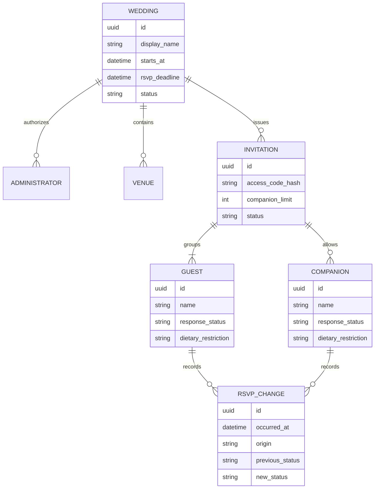

# Wedding Platform — Especificação do Produto e Plano de Engenharia

> Status: aprovado como baseline inicial<br>
> Versão: 1.0.0<br>
> Última atualização: 29/07/2026<br>
> Responsável: Tobias Felipe Kiefer

## 1. Propósito deste documento

Este documento é a fonte de verdade inicial da **Wedding Platform**. Ele descreve o problema que o produto resolve, o resultado esperado, as regras de negócio, os requisitos, o recorte do MVP, a evolução planejada e os critérios usados para considerar cada etapa concluída.

O documento deve evoluir junto com o produto. Alterações relevantes de escopo, regra de negócio ou arquitetura devem ser registradas aqui ou vinculadas a uma decisão arquitetural em `docs/adr` quando essa estrutura existir.

## 2. Resumo executivo

A Wedding Platform será uma aplicação web para centralizar informações de um casamento e simplificar a gestão de convidados e confirmações de presença. Os noivos poderão configurar o evento, administrar convidados, gerar convites individuais e acompanhar respostas. Os convidados poderão consultar as informações públicas e responder ao convite por meio de um código individual, sem precisar criar uma conta.

Além de entregar um produto utilizável, o projeto será desenvolvido como exercício prático de engenharia de software. A solução deverá demonstrar análise de requisitos, arquitetura evolutiva, qualidade automatizada, segurança, observabilidade, entrega contínua e operação em ambiente publicado.

## 3. Visão do produto

### 3.1 Problema

A organização de um casamento distribui informações e tarefas entre planilhas, mensagens e ferramentas sem integração. Isso dificulta manter a lista de convidados atualizada, coletar confirmações, controlar acompanhantes e restrições alimentares e comunicar informações confiáveis sobre o evento.

### 3.2 Proposta de valor

Oferecer aos noivos um único lugar para publicar informações e administrar convites, enquanto o convidado recebe uma experiência simples, responsiva e personalizada para consultar o evento e confirmar presença.

### 3.3 Objetivos do produto

- Centralizar as informações essenciais do casamento.
- Reduzir o trabalho manual de coleta e consolidação de confirmações.
- Permitir que cada convite determine quem pode responder e quantos acompanhantes são aceitos.
- Fornecer uma visão atualizada da quantidade de confirmados, recusas e respostas pendentes.
- Manter uma experiência simples em dispositivos móveis, principal meio de acesso dos convidados.
- Criar uma base técnica que possa evoluir sem exigir uma reescrita prematura.

### 3.4 Objetivos de aprendizagem e portfólio

- Aplicar Java e Spring Boot em um domínio real.
- Praticar testes unitários, de integração, de contrato e ponta a ponta.
- Aplicar princípios de arquitetura, design patterns e modelagem de domínio.
- Configurar banco relacional, migrações e ambientes reproduzíveis com Docker.
- Implementar autenticação, autorização e práticas de segurança.
- Criar uma pipeline de integração e entrega contínua.
- Operar a aplicação com proxy reverso, logs, métricas e alertas.
- Evoluir partes adequadas para comunicação assíncrona e, apenas quando justificado, microsserviços.

### 3.5 Indicadores de sucesso

O MVP será considerado bem-sucedido quando:

- os noivos conseguirem configurar e publicar um casamento;
- for possível cadastrar ou importar todos os convidados necessários;
- cada grupo familiar receber um convite identificável por código único;
- um convidado conseguir confirmar ou recusar presença pelo celular;
- limites de acompanhantes e restrições alimentares forem respeitados;
- o painel apresentar totais coerentes com as respostas registradas;
- a aplicação estiver publicada, protegida por HTTPS, monitorada e recuperável por backup;
- o fluxo principal estiver coberto por testes automatizados e pela pipeline de CI.

## 4. Escopo

### 4.1 Escopo do MVP

#### Site público

- Página inicial do casamento.
- Identificação do casal, data e horário do evento.
- Informações de cerimônia e recepção.
- Orientações importantes, como traje, estacionamento e contato.
- Layout responsivo e acessível.
- Acesso à confirmação de presença.

#### Administração

- Login e logout dos administradores.
- Configuração dos dados básicos do casamento.
- Cadastro, edição, consulta e inativação de convidados.
- Organização de convidados por convite ou grupo familiar.
- Definição do limite de acompanhantes por convite.
- Geração de código e link individual de convite.
- Consulta e filtro de respostas.
- Dashboard com confirmados, recusas e pendentes.
- Visualização de acompanhantes e restrições alimentares.

#### Confirmação de presença

- Identificação por código de convite.
- Exibição das pessoas vinculadas ao convite.
- Confirmação ou recusa de presença por pessoa elegível.
- Cadastro de acompanhantes dentro do limite permitido.
- Registro de restrições alimentares.
- Alteração da resposta até a data-limite definida.
- Confirmação visual de que a resposta foi salva.

### 4.2 Fora do escopo do MVP

Os itens abaixo pertencem ao roadmap e não devem bloquear a primeira entrega:

- Envio automático por WhatsApp, SMS ou e-mail.
- QR Code e check-in presencial.
- Lista de presentes e pagamentos.
- Upload colaborativo de fotos.
- Organização de mesas.
- Aplicativo móvel nativo.
- Suporte completo a múltiplos idiomas.
- Marketplace de fornecedores.
- Arquitetura distribuída em microsserviços.
- Alta disponibilidade multi-região.

### 4.3 Premissas iniciais

- A primeira versão atenderá a um casamento por instalação, mas o domínio não deve impedir evolução futura para múltiplos eventos.
- Haverá inicialmente um ou dois administradores, normalmente os noivos.
- Convidados não precisarão criar conta; o código do convite dará acesso somente aos dados necessários para responder.
- O idioma inicial será português do Brasil.
- Datas e horários serão armazenados de forma não ambígua e apresentados no fuso configurado para o evento.
- O canal de distribuição do link do convite será manual no MVP.

## 5. Stakeholders e atores

| Ator | Interesse | Responsabilidades principais |
|---|---|---|
| Noivos/administradores | Organizar o evento e acompanhar respostas | Configurar evento, administrar convidados e consultar indicadores |
| Convidado responsável | Responder por seu convite ou grupo | Confirmar presença e manter os dados do grupo corretos |
| Acompanhante | Participar associado a um convite | Informar nome e, quando aplicável, restrição alimentar |
| Operador técnico | Manter o sistema disponível e seguro | Publicar, monitorar, realizar backup e tratar incidentes |
| Visitante | Consultar informações públicas | Navegar apenas pelo conteúdo publicado |

## 6. Glossário do domínio

| Termo | Definição |
|---|---|
| Casamento | Evento configurado e publicado na plataforma |
| Administrador | Usuário autenticado autorizado a gerenciar o casamento |
| Convidado | Pessoa previamente cadastrada e vinculada a um convite |
| Convite | Unidade de acesso que agrupa um ou mais convidados e define permissões de resposta |
| Responsável pelo convite | Pessoa que utiliza o código e responde pelo grupo |
| Acompanhante | Pessoa adicionada durante a resposta, quando o convite permite |
| RSVP | Resposta de presença: confirmada, recusada ou pendente |
| Data-limite | Instante após o qual o convidado não pode alterar a resposta sem intervenção do administrador |
| Restrição alimentar | Informação declarada para apoiar o planejamento do buffet |

## 7. Jornadas principais

### 7.1 Preparar e publicar o evento

1. O administrador entra na área restrita.
2. Configura casal, data, locais, textos e data-limite de confirmação.
3. Revisa uma prévia do site.
4. Publica o evento.
5. Visitantes passam a visualizar somente os dados marcados como públicos.

### 7.2 Cadastrar e convidar um grupo

1. O administrador cria o convite.
2. Vincula os convidados conhecidos ao grupo.
3. Define se acompanhantes adicionais são permitidos e o respectivo limite.
4. O sistema gera um código aleatório e não previsível.
5. O administrador copia e envia o link pelo canal de sua escolha.

### 7.3 Responder ao convite

1. O responsável acessa o link individual.
2. O sistema valida o código e apresenta somente o grupo correspondente.
3. O responsável informa a presença de cada pessoa.
4. Se permitido, inclui acompanhantes até o limite.
5. Informa restrições alimentares, revisa e envia a resposta.
6. O sistema persiste a resposta e mostra um protocolo ou confirmação inequívoca.

### 7.4 Acompanhar confirmações

1. O administrador acessa o dashboard.
2. Consulta totais e filtros por estado da resposta.
3. Abre um convite para conferir participantes e restrições.
4. Se necessário, corrige dados ou registra uma resposta recebida por outro canal.

## 8. Regras de negócio

Cada regra possui um identificador estável para ser referenciada em histórias, testes e commits.

### 8.1 Evento e publicação

- **RN-EVT-001:** um casamento deve possuir nome de exibição, data, horário e ao menos um local antes de ser publicado.
- **RN-EVT-002:** alterações salvas como rascunho não devem aparecer no site público até a publicação.
- **RN-EVT-003:** a data-limite de RSVP não pode ser posterior ao início do evento.
- **RN-EVT-004:** somente administradores autorizados podem publicar, despublicar ou alterar o evento.
- **RN-EVT-005:** conteúdo não publicado ou desativado não pode ser consultado por visitantes.

### 8.2 Convites e convidados

- **RN-INV-001:** todo convite ativo deve possuir um código único, aleatório, não sequencial e não reutilizado.
- **RN-INV-002:** um convidado previamente cadastrado pertence a somente um convite ativo no mesmo casamento.
- **RN-INV-003:** um convite deve possuir ao menos um convidado ou responsável identificado para ser enviado.
- **RN-INV-004:** o limite de acompanhantes deve ser um número inteiro maior ou igual a zero.
- **RN-INV-005:** inativar um convite deve impedir novos acessos pelo código, preservando o histórico.
- **RN-INV-006:** dados de outros convites nunca devem ser expostos ao convidado.
- **RN-INV-007:** o administrador pode regenerar o código; ao fazê-lo, o código anterior deve deixar de funcionar.

### 8.3 RSVP

- **RN-RSVP-001:** cada pessoa vinculada ao convite pode estar com resposta pendente, confirmada ou recusada.
- **RN-RSVP-002:** uma resposta só pode incluir pessoas vinculadas ao convite acessado.
- **RN-RSVP-003:** o total de acompanhantes adicionados não pode ultrapassar o limite do convite.
- **RN-RSVP-004:** o nome de cada acompanhante confirmado é obrigatório.
- **RN-RSVP-005:** antes da data-limite, o responsável pode revisar e alterar a resposta.
- **RN-RSVP-006:** após a data-limite, somente um administrador pode criar ou alterar respostas.
- **RN-RSVP-007:** toda alteração deve registrar data, origem e, quando autenticado, autor.
- **RN-RSVP-008:** reenvios da mesma operação não podem gerar acompanhantes ou respostas duplicadas.
- **RN-RSVP-009:** a confirmação deve ser transacional: ou todas as alterações válidas do grupo são salvas, ou nenhuma é.
- **RN-RSVP-010:** o dashboard deve refletir apenas a versão mais recente de cada resposta, sem perder o histórico de mudanças.

### 8.4 Privacidade e retenção

- **RN-PRV-001:** somente os dados pessoais estritamente necessários ao evento devem ser coletados.
- **RN-PRV-002:** restrições alimentares são opcionais e devem ter finalidade claramente informada.
- **RN-PRV-003:** dados pessoais não podem aparecer em logs de aplicação, métricas ou mensagens de erro.
- **RN-PRV-004:** o administrador pode corrigir e excluir logicamente dados de convidados sem comprometer registros técnicos necessários.
- **RN-PRV-005:** deve existir uma política de retenção e descarte após o evento antes da disponibilização pública do produto.

## 9. Requisitos funcionais

### 9.1 Prioridade MoSCoW

- **Must:** obrigatório para o MVP.
- **Should:** importante, planejado após estabilização do MVP.
- **Could:** desejável, sem compromisso para a primeira versão.
- **Won't now:** explicitamente adiado.

| ID | Requisito | Prioridade | Fase |
|---|---|---:|---:|
| RF-001 | Autenticar e encerrar sessão de administrador | Must | 1 |
| RF-002 | Consultar e editar configurações do casamento | Must | 1 |
| RF-003 | Salvar rascunho, visualizar prévia e publicar conteúdo | Must | 2 |
| RF-004 | Cadastrar, editar, consultar e inativar convidados | Must | 1 |
| RF-005 | Criar convites e agrupar convidados | Must | 1 |
| RF-006 | Configurar limite de acompanhantes | Must | 1 |
| RF-007 | Gerar e regenerar link individual | Must | 1 |
| RF-008 | Identificar um convite por código válido | Must | 1 |
| RF-009 | Confirmar ou recusar cada participante | Must | 1 |
| RF-010 | Adicionar acompanhantes dentro do limite | Must | 1 |
| RF-011 | Informar restrições alimentares | Must | 1 |
| RF-012 | Alterar RSVP antes da data-limite | Must | 1 |
| RF-013 | Consultar dashboard e filtrar respostas | Must | 1 |
| RF-014 | Administrador registrar ou corrigir RSVP | Must | 1 |
| RF-015 | Exibir site público responsivo | Must | 2 |
| RF-016 | Importar convidados por arquivo CSV | Should | 3 |
| RF-017 | Exportar lista e respostas em CSV | Should | 3 |
| RF-018 | Enviar lembretes por canal integrado | Should | 4 |
| RF-019 | Registrar check-in por QR Code | Could | 5 |
| RF-020 | Organizar convidados por mesa | Could | 5 |
| RF-021 | Disponibilizar galeria colaborativa | Could | 5 |
| RF-022 | Processar lista de presentes ou pagamentos | Won't now | — |

## 10. Requisitos não funcionais

### 10.1 Segurança e privacidade

- **RNF-SEC-001:** todo tráfego em produção deve usar HTTPS.
- **RNF-SEC-002:** senhas devem ser armazenadas somente com algoritmo de hash adaptativo aprovado pelo Spring Security.
- **RNF-SEC-003:** endpoints administrativos devem exigir autenticação e autorização.
- **RNF-SEC-004:** códigos de convite devem possuir entropia suficiente para resistir a enumeração e tentativa aleatória.
- **RNF-SEC-005:** autenticação e consulta de códigos devem possuir limitação de tentativas.
- **RNF-SEC-006:** entradas devem ser validadas no servidor, independentemente da validação do frontend.
- **RNF-SEC-007:** segredos nunca devem ser versionados e devem entrar por variáveis ou serviço de segredos.
- **RNF-SEC-008:** dependências e imagens de container devem ser verificadas automaticamente contra vulnerabilidades conhecidas.
- **RNF-SEC-009:** o tratamento de dados deve observar princípios e obrigações aplicáveis da LGPD; uma revisão jurídica será necessária antes de uso comercial.

### 10.2 Desempenho e capacidade

- **RNF-PERF-001:** em condições normais, 95% das requisições de leitura do MVP devem responder em até 500 ms no backend, excluindo latência de rede.
- **RNF-PERF-002:** operações de escrita do RSVP devem responder em até 1 segundo no percentil 95.
- **RNF-PERF-003:** páginas públicas devem atingir desempenho móvel satisfatório, com meta inicial de Lighthouse Performance maior ou igual a 80.
- **RNF-PERF-004:** a primeira versão deve suportar ao menos 500 convites e 1.500 participantes por casamento sem degradação perceptível.
- **RNF-PERF-005:** consultas administrativas devem usar paginação quando retornarem coleções.

### 10.3 Disponibilidade, recuperação e operação

- **RNF-OPS-001:** meta inicial de disponibilidade mensal em produção de 99,5%, excluindo manutenção programada.
- **RNF-OPS-002:** o sistema deve expor verificações de saúde e prontidão sem revelar dados sensíveis.
- **RNF-OPS-003:** logs devem ser estruturados, correlacionáveis e possuir níveis adequados.
- **RNF-OPS-004:** métricas mínimas devem incluir latência, volume, erros, recursos e disponibilidade.
- **RNF-OPS-005:** o banco de produção deve possuir backup automatizado, criptografado e com teste periódico de restauração.
- **RNF-OPS-006:** metas iniciais: RPO de 24 horas e RTO de 4 horas.
- **RNF-OPS-007:** uma versão anterior deve poder ser restaurada por procedimento documentado.

### 10.4 Qualidade, acessibilidade e compatibilidade

- **RNF-QLT-001:** a pipeline deve bloquear integração quando build, análise estática ou testes obrigatórios falharem.
- **RNF-QLT-002:** regras de negócio críticas devem possuir testes unitários e de integração.
- **RNF-QLT-003:** os fluxos de login, criação de convite e RSVP devem possuir testes ponta a ponta antes do lançamento do MVP.
- **RNF-QLT-004:** APIs públicas do projeto devem ser documentadas com OpenAPI.
- **RNF-QLT-005:** o site deve funcionar nas duas versões mais recentes dos navegadores Chrome, Edge, Firefox e Safari.
- **RNF-QLT-006:** a interface deve buscar conformidade WCAG 2.2 nível AA nos fluxos principais.
- **RNF-QLT-007:** componentes devem apresentar estados de carregamento, vazio, sucesso e erro.

### 10.5 Manutenibilidade

- **RNF-MNT-001:** o backend deve começar como monólito modular, com dependências explícitas entre domínios.
- **RNF-MNT-002:** alterações no banco devem ser versionadas por migrações e nunca depender de edição manual em produção.
- **RNF-MNT-003:** ambientes locais devem ser reproduzíveis com instruções documentadas e Docker Compose para dependências.
- **RNF-MNT-004:** decisões arquiteturais significativas devem ser registradas como ADRs.
- **RNF-MNT-005:** eventos assíncronos e microsserviços só devem ser introduzidos quando houver caso de uso e benefício mensurável.

## 11. Modelo conceitual inicial



Este modelo é conceitual. Identificadores, cardinalidades e armazenamento do código deverão ser confirmados durante o desenho técnico. A recomendação inicial é não armazenar o código sensível em texto puro caso a consulta possa ser implementada com segurança usando hash ou token dividido.

## 12. Arquitetura e tecnologia esperadas

### 12.1 Estratégia arquitetural

O sistema começará como **monólito modular**. Os módulos devem representar capacidades do negócio e evitar acoplamento acidental. A separação inicial sugerida é:

```text
backend
└── com.tobias.wedding
    ├── auth
    ├── wedding
    ├── guest
    ├── invitation
    ├── rsvp
    └── shared
```

Princípios:

- regras de negócio não dependem de detalhes de interface ou infraestrutura;
- transações permanecem locais enquanto isso for suficiente;
- comunicação entre módulos utiliza contratos explícitos;
- eventos de domínio podem ser internos antes da adoção de um broker;
- extração de microsserviço exige motivação registrada em ADR, observabilidade e estratégia de consistência.

### 12.2 Stack inicial proposta

| Área | Tecnologia proposta |
|---|---|
| Backend | Java 21, Spring Boot, Spring Web, Spring Security, Spring Data JPA, Bean Validation |
| Banco | PostgreSQL e Flyway |
| Mapeamento/API | MapStruct e OpenAPI/Swagger |
| Testes backend | JUnit 5, Mockito, Testcontainers e ArchUnit quando aplicável |
| Frontend | Angular, TypeScript, Reactive Forms e biblioteca visual a decidir |
| Testes frontend | Testes unitários do ecossistema Angular e Playwright/Cypress a decidir |
| Ambiente local | Docker e Docker Compose |
| Entrada em produção | Nginx como proxy reverso e terminação TLS, conforme ambiente escolhido |
| CI/CD | GitHub Actions |
| Observabilidade | Actuator, Prometheus, Grafana e solução de logs a decidir |
| Mensageria futura | RabbitMQ, introduzido primeiro em um caso de uso não crítico |

### 12.3 Estratégia de evolução

1. Consolidar o monólito modular e o fluxo transacional de RSVP.
2. Publicar eventos internos após mudanças relevantes.
3. Introduzir RabbitMQ para uma tarefa assíncrona tolerante a repetição, como notificação.
4. Implementar outbox, idempotência, retentativas e fila de mensagens mortas.
5. Medir acoplamento e carga antes de considerar extração.
6. Extrair um serviço somente se limites de domínio, operação e dados estiverem claros.

## 13. Estratégia de qualidade

### 13.1 Pirâmide de testes

- **Testes unitários:** regras de domínio, validações e casos de erro.
- **Testes de integração:** persistência, migrações, segurança e endpoints com PostgreSQL real via Testcontainers.
- **Testes de contrato:** compatibilidade entre frontend e API e, futuramente, entre serviços.
- **Testes ponta a ponta:** poucos fluxos críticos executados em ambiente próximo ao real.
- **Testes arquiteturais:** limites de módulos e dependências permitidas.
- **Testes não funcionais:** carga básica, acessibilidade, restauração de backup e segurança automatizada.

### 13.2 Casos críticos obrigatórios

- Código inexistente, expirado, inativo ou regenerado não concede acesso.
- Um convite não permite consultar outro grupo.
- Limite de acompanhantes não pode ser ultrapassado, inclusive sob requisições concorrentes.
- Reenvio de uma resposta não duplica dados.
- Falha parcial não deixa o grupo com uma resposta inconsistente.
- Data-limite bloqueia alterações públicas, mas permite intervenção administrativa auditada.
- Dashboard apresenta totais coerentes após criação, alteração e recusa.
- Dados sensíveis não são expostos em erros ou logs.

### 13.3 Definition of Ready

Uma história está pronta para desenvolvimento quando:

- possui problema e valor claramente descritos;
- possui critérios de aceite testáveis;
- identifica regras de negócio relacionadas;
- dependências e dúvidas críticas estão resolvidas;
- impacto em segurança, dados e observabilidade foi considerado;
- cabe em um ciclo curto de implementação.

### 13.4 Definition of Done

Uma história está concluída quando:

- critérios de aceite foram atendidos;
- código foi revisado e integrado;
- testes relevantes foram criados e estão passando;
- análise estática não apresenta falhas bloqueantes;
- migrações são reversíveis ou possuem plano seguro de avanço;
- API e documentação foram atualizadas;
- logs, métricas e tratamento de erro foram considerados;
- funcionalidade foi validada em ambiente integrado;
- não há segredo ou dado pessoal indevido no repositório e nos logs.

## 14. Processo de engenharia de software

O projeto seguirá ciclos incrementais, não uma sequência rígida em cascata. Cada incremento passa pelas atividades abaixo na profundidade proporcional ao risco:

1. **Descoberta:** entender problema, ator, valor, restrições e hipóteses.
2. **Especificação:** registrar regra, requisito, fluxo e critérios de aceite.
3. **Desenho:** modelar dados, contrato, interface e decisão arquitetural.
4. **Planejamento:** dividir em histórias pequenas, priorizar e estimar.
5. **Implementação:** desenvolver verticalmente, com frontend, backend e dados quando aplicável.
6. **Verificação:** executar revisão, testes e verificações não funcionais.
7. **Entrega:** publicar em ambiente de homologação e, após aceite, em produção.
8. **Operação:** observar métricas e logs, tratar incidentes e coletar feedback.
9. **Evolução:** revisar hipóteses e atualizar backlog e documentação.

### 14.1 Artefatos previstos

- Visão, escopo e requisitos: este documento.
- Backlog: issues com história, critérios de aceite e vínculos para requisitos.
- Contrato da API: OpenAPI versionado junto ao backend.
- Modelo de dados: migrações Flyway e diagrama atualizado.
- Decisões técnicas: Architecture Decision Records (ADRs).
- Interface: wireframes e protótipo quando necessário.
- Qualidade: estratégia e relatórios automatizados da pipeline.
- Operação: runbook de deploy, rollback, backup, restauração e incidentes.
- Releases: changelog e notas de versão.

### 14.2 Rastreabilidade

O fluxo de rastreabilidade recomendado é:

```text
Objetivo → Requisito/RN → Issue → Pull Request → Teste → Release
```

Issues devem citar os identificadores afetados, por exemplo `RF-009`, `RN-RSVP-003` e `RNF-SEC-006`.

## 15. Backlog macro e cronograma proposto

### 15.1 Premissa de planejamento

O cronograma abaixo considera uma pessoa trabalhando aproximadamente **8 a 12 horas por semana**. É uma previsão inicial, não um compromisso fixo. Ao final de cada fase, duração e escopo devem ser recalibrados usando a velocidade real e o aprendizado obtido.

| Fase | Semanas | Resultado esperado | Marco de aceite |
|---|---:|---|---|
| 0. Descoberta e fundação | 1–2 | Requisitos revisados, backlog inicial, repositório, decisões básicas e ambiente local | Projeto inicia localmente; documentação e pipeline mínima existem |
| 1. MVP de convites e RSVP | 3–8 | Administração, convidados, convites, respostas e dashboard | Fluxo completo passa em testes e pode ser demonstrado em homologação |
| 2. Site público e lançamento | 9–11 | Conteúdo público responsivo, acabamento, segurança e produção | MVP disponível por HTTPS, monitorado e com backup validado |
| 3. Operação e produtividade | 12–14 | Importação/exportação, auditoria melhorada e observabilidade | Operação rotineira pode ser realizada com procedimentos documentados |
| 4. Comunicação assíncrona | 15–18 | Notificações com RabbitMQ, resiliência e rastreabilidade | Falhas e duplicidades são tratadas sem corromper o estado do RSVP |
| 5. Funcionalidades avançadas | 19–24 | Check-in, mesas ou galeria, conforme prioridade validada | Incrementos entregues com os mesmos padrões de qualidade |
| 6. Avaliação de microsserviços | Após a semana 24 | Estudo medido e possível extração de um contexto | ADR comprova necessidade; implantação independente é observável e segura |

### 15.2 Fase 0 — Descoberta e fundação

- Revisar este documento e resolver decisões em aberto.
- Criar histórias do MVP e priorizar o backlog.
- Desenhar wireframes dos fluxos público, RSVP e administrativo.
- Criar repositório e convenções de contribuição.
- Gerar projetos Spring Boot e Angular.
- Subir PostgreSQL local com Docker Compose.
- Configurar migrações, perfis e tratamento básico de erros.
- Configurar pipeline de build, testes e análise estática.
- Registrar ADRs de arquitetura, autenticação e estratégia do código de convite.

### 15.3 Fase 1 — MVP de convites e RSVP

- Implementar autenticação e autorização administrativa.
- Modelar e implementar configurações do casamento.
- Implementar convidados e agrupamento em convites.
- Gerar e validar código individual.
- Implementar o fluxo público de RSVP.
- Aplicar limite de acompanhantes, data-limite e idempotência.
- Implementar administração de respostas.
- Criar dashboard inicial.
- Cobrir o fluxo com testes unitários, integração e E2E.

### 15.4 Fase 2 — Site público e lançamento

- Implementar páginas públicas e prévia.
- Trabalhar responsividade, acessibilidade e estados de interface.
- Executar revisão de segurança e privacidade.
- Preparar imagens de container e proxy reverso.
- Configurar ambiente de homologação e produção.
- Automatizar deploy e rollback.
- Configurar logs, métricas, alertas e backups.
- Executar testes de aceite e publicar a versão 1.0.

### 15.5 Fases posteriores

- Medir uso e corrigir problemas antes de expandir escopo.
- Implementar importação e exportação.
- Adicionar notificações assíncronas com garantias operacionais.
- Escolher funcionalidades avançadas conforme valor real.
- Avaliar microsserviços com base em evidências, não como objetivo isolado.

## 16. Critérios de aceite do MVP

O MVP estará pronto para lançamento quando todas as condições forem verdadeiras:

### Produto

- O administrador configura e publica o casamento.
- O administrador gerencia convidados, convites e respostas.
- Um link válido permite responder apenas pelo convite correspondente.
- Limite de acompanhantes e data-limite são aplicados no servidor.
- O convidado consegue concluir o fluxo em tela móvel sem assistência.
- O dashboard diferencia pessoas confirmadas, recusadas e pendentes.

### Qualidade

- Build reproduzível e pipeline principal em estado verde.
- Testes críticos definidos na seção 13 estão automatizados.
- Não existem defeitos conhecidos de severidade crítica ou alta.
- Migrações são executadas automaticamente em ambiente limpo.
- Verificações básicas de acessibilidade e compatibilidade foram concluídas.

### Segurança e operação

- HTTPS, autorização, limitação de tentativas e gestão de segredos estão ativos.
- Dependências não possuem vulnerabilidade crítica conhecida sem mitigação registrada.
- Logs e métricas permitem diagnosticar falhas do fluxo principal.
- Backup automatizado e restauração foram testados.
- Deploy e rollback possuem procedimentos documentados e ensaiados.
- Política de privacidade e retenção está definida para o uso pretendido.

### Documentação

- README permite executar o projeto localmente.
- OpenAPI descreve os endpoints disponíveis.
- Decisões arquiteturais relevantes possuem ADR.
- Runbook descreve operação, deploy, rollback e recuperação.

## 17. Riscos e estratégias de mitigação

| Risco | Probabilidade | Impacto | Mitigação |
|---|---:|---:|---|
| Escopo crescer antes do MVP | Alta | Alto | Respeitar a lista “fora do escopo” e priorizar por valor |
| Introdução prematura de microsserviços | Alta | Alto | Começar modular e exigir ADR baseado em evidência |
| Exposição de dados por códigos previsíveis | Média | Alto | Tokens fortes, limitação de tentativas, testes e revisão de segurança |
| Inconsistência em respostas concorrentes | Média | Alto | Transações, restrições no banco, idempotência e testes concorrentes |
| Baixa disponibilidade perto do evento | Baixa/Média | Alto | Monitoramento, backup, teste de carga e plano operacional |
| Cronograma incompatível com disponibilidade | Alta | Médio | Trabalhar por marcos, medir velocidade e reduzir escopo da fase |
| Stack ampla atrasar o aprendizado do domínio | Média | Médio | Introduzir uma capacidade técnica somente quando a fase exigir |
| Uso inadequado de dados pessoais | Média | Alto | Minimização, acesso restrito, retenção definida e revisão da LGPD |
| Dependência de serviços gratuitos | Média | Médio | Documentar limites e manter estratégia de migração/backup |

## 18. Decisões em aberto

Estas decisões devem ser resolvidas durante a Fase 0:

- Nome público definitivo do produto.
- Plataforma de hospedagem e orçamento mensal aceitável.
- Biblioteca visual do frontend.
- Estratégia de autenticação administrativa e recuperação de senha.
- Forma segura de geração, armazenamento e rotação do código de convite.
- Necessidade de múltiplos administradores e seus papéis.
- Se cada pessoa do grupo responde individualmente ou o responsável responde por todos.
- Quais informações do evento são públicas sem código.
- Política definitiva de privacidade, retenção e exclusão.
- Canal da primeira integração de notificações.
- Ferramentas definitivas de teste E2E, logs e rastreamento de erros.

## 19. Governança do documento

- A versão deve mudar quando houver alteração relevante de escopo ou regra.
- Regras e requisitos removidos não devem ter seus identificadores reutilizados.
- Hipóteses devem ser validadas com usuários reais ou explicitamente aceitas pelos responsáveis.
- Alterações que impactem prazo devem atualizar o cronograma e o backlog.
- Uma revisão formal deve ocorrer ao final de cada fase.

### Histórico de versões

| Versão | Data | Alteração |
|---|---|---|
| 0.1.0 | 29/07/2026 | Criação da visão, escopo, regras, requisitos, arquitetura, qualidade e cronograma inicial |
| 1.0.0 | 29/07/2026 | Aprovação da especificação como baseline inicial do projeto |
