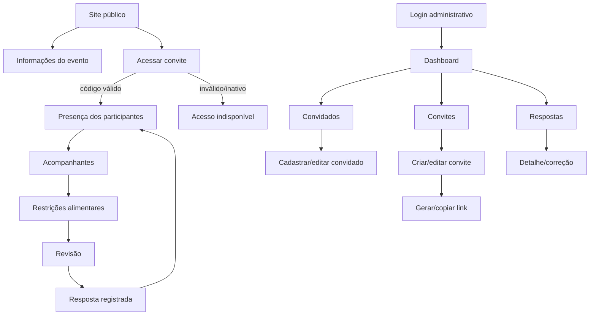

# Wedding Platform — Wireframes de baixa fidelidade

> Status: baseline para implementação<br>
> Versão: 2.1.0<br>
> Última atualização: 11/08/2026<br>
> Responsável: Tobias Felipe Kiefer

## 1. Objetivo

Este documento descreve a navegação, a hierarquia de informação e os estados das telas principais da Wedding Platform antes da implementação. Os wireframes são deliberadamente simples: representam conteúdo e comportamento, não o acabamento visual.

Eles devem orientar a divisão de componentes, os contratos entre frontend e backend e os testes de aceite. Durante a implementação, ajustes de apresentação são permitidos desde que preservem as regras, os dados e os fluxos documentados.

## 2. Escopo e limites

### Incluído

- Mapa de navegação das áreas pública e administrativa.
- Sequências de telas para as jornadas principais.
- Wireframes textuais em baixa fidelidade.
- Comportamentos responsivos essenciais.
- Estados de carregamento, vazio, sucesso, erro e acesso bloqueado.
- Rastreabilidade com requisitos e regras de negócio.

### Não incluído

- Protótipo interativo ou navegável.
- Identidade visual, logotipo ou escolha definitiva de cores.
- Layout em precisão de pixels.
- Biblioteca de componentes definitiva.
- Animações e transições.
- Conteúdo editorial final do casamento.

## 3. Premissas de experiência

- O RSVP será **mobile first**, pois o link será acessado principalmente pelo celular.
- Convidados não criarão conta; o código individual identifica o convite.
- A área administrativa exigirá autenticação.
- A navegação do convidado deve mostrar uma decisão principal por etapa.
- O responsável revisará todo o grupo antes de enviar a resposta.
- Ações destrutivas ou que invalidem acesso exigirão confirmação explícita.
- Validação no cliente melhora a experiência, mas o servidor continuará sendo a autoridade.
- Textos de erro não confirmarão a existência passada ou atual de um código.

## 4. Mapa de navegação



## 5. Estrutura geral

### 5.1 Área pública

```text
┌─────────────────────────────────────┐
│ [Casal]                    [RSVP]   │
├─────────────────────────────────────┤
│                                     │
│            Conteúdo                 │
│                                     │
├─────────────────────────────────────┤
│ Privacidade · Contato               │
└─────────────────────────────────────┘
```

Em telas estreitas, o conteúdo ocupa a largura disponível, com margens mínimas consistentes. A ação de RSVP deve permanecer fácil de localizar sem cobrir o conteúdo.

### 5.2 Área administrativa

```text
┌──────────────────────────────────────────────────────────────┐
│ Wedding Platform                       [Conta] [Sair]        │
├──────────────┬───────────────────────────────────────────────┤
│ Dashboard    │                                               │
│ Convidados   │                                               │
│ Convites     │                                               │
│ Respostas    │                                               │
└──────────────┴───────────────────────────────────────────────┘
```

Em telas estreitas, a navegação lateral se transforma em menu recolhível. Tabelas passam a usar cartões ou rolagem controlada, sem esconder ações essenciais.

## 6. Fluxo administrativo

### 6.1 Login

```text
┌─────────────────────────────────────┐
│          Wedding Platform           │
│                                     │
│ E-mail                              │
│ [_______________________________]   │
│                                     │
│ Senha                         [ver] │
│ [_______________________________]   │
│                                     │
│ [            Entrar             ]   │
│                                     │
│ [mensagem de erro genérica]         │
└─────────────────────────────────────┘
```

Comportamento:

- botão desabilitado durante o envio;
- erro de credencial não identifica se e-mail ou senha está incorreto;
- após sucesso, direciona ao dashboard;
- sessão expirada direciona ao login e explica que é necessário entrar novamente.

Referências: RF-001, RNF-SEC-002, RNF-SEC-003 e RNF-SEC-005.

### 6.2 Dashboard

```text
┌──────────────────────────────────────────────────────────────┐
│ Dashboard                                      [Atualizar]   │
├────────────────┬────────────────┬────────────────────────────┤
│ Confirmados    │ Recusaram      │ Pendentes                  │
│      000       │      000       │      000                   │
├────────────────┴────────────────┴────────────────────────────┤
│ Respostas recentes                                          │
│ ┌──────────────┬────────────┬───────────┬─────────────────┐  │
│ │ Convite      │ Pessoas    │ Estado    │ Atualizado em   │  │
│ └──────────────┴────────────┴───────────┴─────────────────┘  │
│                                                              │
│ [Ver todas as respostas]                                    │
└──────────────────────────────────────────────────────────────┘
```

Estados:

- **carregando:** esqueletos preservam o espaço dos indicadores;
- **vazio:** explica que ainda não existem convites ou respostas e oferece a próxima ação;
- **erro:** mantém a navegação disponível e permite tentar novamente;
- **sucesso:** totais consideram apenas a versão atual de cada resposta.

Referências: RF-013, RN-RSVP-010, RNF-PERF-001 e RNF-PERF-005.

### 6.3 Lista de convidados

```text
┌──────────────────────────────────────────────────────────────┐
│ Convidados                              [Cadastrar convidado] │
├──────────────────────────────────────────────────────────────┤
│ [Buscar por nome________________] [Estado ▾] [Buscar]        │
├──────────────────────────────────────────────────────────────┤
│ Nome              │ Convite/Grupo       │ Estado │ Ações     │
│ Ana Exemplo       │ Família Exemplo     │ Ativo  │ [⋮]       │
│ Bruno Exemplo     │ Sem convite         │ Ativo  │ [⋮]       │
├──────────────────────────────────────────────────────────────┤
│ Exibindo 1–20 de 000                       [Anterior] [Próx.] │
└──────────────────────────────────────────────────────────────┘
```

Menu de ações: editar, inativar/reativar e abrir convite vinculado. A inativação deve explicar o impacto antes da confirmação.

Estado vazio:

```text
Nenhum convidado cadastrado.
Cadastre a primeira pessoa para começar a organizar os convites.
[Cadastrar convidado]
```

Referências: RF-004, RN-INV-002, RN-PRV-001, RN-PRV-004 e RNF-PERF-005.

### 6.4 Cadastro e edição de convidado

```text
┌──────────────────────────────────────────────┐
│ Cadastrar convidado                          │
├──────────────────────────────────────────────┤
│ Nome completo                                │
│ [__________________________________________] │
│                                              │
│ Contato (opcional no MVP)                    │
│ [__________________________________________] │
│                                              │
│ Estado                                       │
│ (●) Ativo   ( ) Inativo                     │
│                                              │
│                       [Cancelar] [Salvar]    │
└──────────────────────────────────────────────┘
```

O formulário coleta apenas os dados definidos como necessários. Campos adicionais exigem justificativa de finalidade.

### 6.5 Lista de convites

```text
┌──────────────────────────────────────────────────────────────┐
│ Convites                                   [Criar convite]   │
├──────────────────────────────────────────────────────────────┤
│ [Buscar____________________] [Estado ▾] [Filtrar]           │
├──────────────────────────────────────────────────────────────┤
│ Grupo             │ Pessoas │ Acomp. │ RSVP      │ Ações     │
│ Família Exemplo   │    3    │  0/2   │ Pendente  │ [⋮]       │
├──────────────────────────────────────────────────────────────┤
│ Exibindo 1–20 de 000                       [Anterior] [Próx.] │
└──────────────────────────────────────────────────────────────┘
```

Menu de ações: editar grupo, copiar link, regenerar link, abrir resposta e inativar convite.

Referências: RF-005 a RF-007 e RN-INV-001 a RN-INV-007.

### 6.6 Criação e edição de convite

```text
┌──────────────────────────────────────────────────────────────┐
│ Criar convite                                                │
├──────────────────────────────────────────────────────────────┤
│ Nome do grupo/responsável                                    │
│ [__________________________________________________________] │
│                                                              │
│ Convidados vinculados                                        │
│ [Buscar convidado_________________________] [Adicionar]      │
│ ┌──────────────────────────────────────────────────────────┐ │
│ │ Ana Exemplo                                      [Remover]│ │
│ │ Bruno Exemplo                                    [Remover]│ │
│ └──────────────────────────────────────────────────────────┘ │
│                                                              │
│ Limite de acompanhantes [ 0 ]                                │
│                                                              │
│                                   [Cancelar] [Salvar convite]│
└──────────────────────────────────────────────────────────────┘
```

Validações:

- ao menos um responsável ou convidado;
- convidado não pode estar em outro convite ativo;
- limite inteiro maior ou igual a zero;
- alterações no grupo devem ser salvas de forma consistente.

### 6.7 Link individual

```text
┌──────────────────────────────────────────────┐
│ Link do convite                              │
├──────────────────────────────────────────────┤
│ https://.../convite/••••••••••••••          │
│                                  [Copiar]    │
│                                              │
│ [Regenerar link]                             │
│                                              │
│ O link anterior deixará de funcionar após   │
│ uma regeneração confirmada.                  │
└──────────────────────────────────────────────┘
```

Regenerar abre uma confirmação que descreve o impacto. O novo link só substitui o anterior após sucesso no servidor.

Referências: RF-007, RN-INV-001, RN-INV-005, RN-INV-007 e RNF-SEC-004.

### 6.8 Lista administrativa de respostas

```text
┌──────────────────────────────────────────────────────────────┐
│ Respostas                                                    │
├──────────────────────────────────────────────────────────────┤
│ Prazo público: [08/04/2027] [23:59] [Salvar prazo]          │
│ Após o prazo, apenas o administrador pode corrigir respostas│
├──────────────────────────────────────────────────────────────┤
│ [Buscar_______________] [Estado ▾] [Restrição ▾] [Filtrar] │
├──────────────────────────────────────────────────────────────┤
│ Grupo           │ Confirmados │ Recusas │ Pendentes │ Ações  │
│ Família Exemplo │      2      │    1    │    0      │ [Ver]  │
├──────────────────────────────────────────────────────────────┤
│ Exibindo 1–20 de 000                       [Anterior] [Próx.] │
└──────────────────────────────────────────────────────────────┘
```

### 6.9 Detalhe e correção administrativa

```text
┌──────────────────────────────────────────────────────────────┐
│ Família Exemplo                     Origem: link individual  │
│ Última atualização: 30/07/2026 10:00                        │
├──────────────────────────────────────────────────────────────┤
│ Ana Exemplo       [Confirmada ▾]  Restrição [_____________] │
│ Bruno Exemplo     [Recusou ▾]     Restrição [_____________] │
│                                                              │
│ Acompanhantes (1/2)                                         │
│ Convidado Exemplo [Confirmado ▾] Restrição [_____________]  │
│                                                              │
│ Histórico                                                    │
│ 30/07 · Administrador · resposta corrigida                  │
│                                                              │
│                          [Cancelar] [Salvar correção]         │
└──────────────────────────────────────────────────────────────┘
```

Salvar uma correção solicita confirmação, identifica o autor e preserva a versão anterior no histórico.

Referências: RF-013, RF-014, RN-RSVP-006, RN-RSVP-007, RN-RSVP-010 e RN-RSVP-011.

## 7. Fluxo móvel de RSVP

### 7.1 Entrada pelo convite

O link já contém o código. Não será exigido que o convidado o digite no fluxo normal.

```text
┌───────────────────────────────┐
│       Ana & Bruno             │
│                               │
│ Olá, Família Exemplo!         │
│                               │
│ Confirme a presença do seu    │
│ grupo até 30/09/2026.         │
│                               │
│ Pessoas no convite: 3         │
│ Acompanhantes permitidos: 2   │
│                               │
│ [     Responder convite     ] │
└───────────────────────────────┘
```

O nome do grupo somente aparece após validação segura do código.

### 7.2 Código inválido, inativo ou regenerado

```text
┌───────────────────────────────┐
│ Acesso indisponível           │
│                               │
│ Não foi possível abrir este   │
│ convite. Confira o link       │
│ recebido ou fale com os       │
│ responsáveis pelo evento.     │
│                               │
│ [Voltar ao site]              │
└───────────────────────────────┘
```

A mensagem é a mesma para código inexistente, inativo ou substituído. Não há exposição de participantes.

Referências: RF-008, RN-INV-005, RN-INV-006, RNF-SEC-004 e RNF-SEC-005.

### 7.3 Presença dos participantes

```text
┌───────────────────────────────┐
│ Etapa 1 de 4 · Presença       │
│ ███████░░░░░░░░░░░░░         │
│                               │
│ Ana Exemplo                   │
│ ( ) Vou   ( ) Não vou         │
│                               │
│ Bruno Exemplo                 │
│ ( ) Vou   ( ) Não vou         │
│                               │
│ Carla Exemplo                 │
│ ( ) Vou   ( ) Não vou         │
│                               │
│ [Voltar]          [Continuar] │
└───────────────────────────────┘
```

Comportamento:

- continuar exige resposta válida para os participantes definidos pelo produto;
- nenhum integrante de outro convite aparece;
- uma resposta existente abre com a versão mais recente selecionada.

Referências: RF-009, RN-RSVP-001, RN-RSVP-002 e RN-RSVP-010.

### 7.4 Acompanhantes

```text
┌───────────────────────────────┐
│ Etapa 2 de 4 · Acompanhantes  │
│ ███████████░░░░░░░░░         │
│                               │
│ Você pode adicionar até 2.    │
│                               │
│ Acompanhante 1                │
│ Nome [____________________]   │
│                         [X]   │
│                               │
│ [Adicionar acompanhante]      │
│ 1 de 2 utilizado              │
│                               │
│ [Voltar]          [Continuar] │
└───────────────────────────────┘
```

Estados:

- limite zero: explica que o convite é nominal e não mostra ação de adicionar;
- limite atingido: botão desabilitado com explicação;
- nome vazio: erro associado ao campo;
- concorrência ou alteração do limite: servidor rejeita e a tela recarrega os dados atuais.

Referências: RF-010, RN-RSVP-003, RN-RSVP-004, RN-RSVP-008 e RN-RSVP-009.

### 7.5 Restrições alimentares

```text
┌───────────────────────────────┐
│ Etapa 3 de 4 · Alimentação    │
│ ███████████████░░░░░         │
│                               │
│ Informação opcional usada     │
│ somente no planejamento do    │
│ buffet.                       │
│                               │
│ Ana Exemplo                   │
│ [Sem restrição____________]   │
│                               │
│ Acompanhante 1                │
│ [Vegetariano_______________]  │
│                               │
│ [Voltar]          [Continuar] │
└───────────────────────────────┘
```

Somente participantes confirmados precisam ser apresentados nesta etapa.

Referências: RF-011 e RN-PRV-001 a RN-PRV-003.

### 7.6 Revisão e envio

```text
┌───────────────────────────────┐
│ Etapa 4 de 4 · Revisão        │
│ █████████████████████         │
│                               │
│ Confirmados (2)               │
│ ✓ Ana Exemplo                 │
│ ✓ Acompanhante 1              │
│                               │
│ Não comparece (1)             │
│ × Bruno Exemplo               │
│                               │
│ Restrições                    │
│ Acompanhante 1: vegetariano   │
│                               │
│ [Voltar e editar]             │
│ [     Enviar resposta       ] │
└───────────────────────────────┘
```

Durante o envio, a ação é bloqueada para evitar duplo clique. O servidor aplica idempotência e transação; erro mantém os dados para nova tentativa.

Referências: RN-RSVP-007 a RN-RSVP-009 e RNF-PERF-002.

### 7.7 Sucesso

```text
┌───────────────────────────────┐
│             ✓                 │
│ Resposta registrada           │
│                               │
│ Obrigado por responder.       │
│ Você pode alterar os dados    │
│ até 30/09/2026.               │
│                               │
│ Protocolo: RSVP-••••••        │
│                               │
│ [Revisar minha resposta]      │
│ [Voltar ao site]              │
└───────────────────────────────┘
```

O protocolo não deve permitir enumeração ou acesso a outro convite.

## 8. Site público personalizado

```text
┌─────────────────────────────────────────────┐
│ Ana & Bruno                      [Confirmar]│
├─────────────────────────────────────────────┤
│                                             │
│             10 · OUT · 2026                 │
│       Estamos felizes em celebrar...        │
│                                             │
│ [         Confirmar presença          ]     │
├─────────────────────────────────────────────┤
│ Nossa história                              │
│ [texto e imagem]                            │
├─────────────────────────────────────────────┤
│ Cerimônia               Recepção            │
│ data · hora · local     data · hora · local │
│ [Abrir mapa]            [Abrir mapa]        │
├─────────────────────────────────────────────┤
│ Informações importantes                     │
│ traje · estacionamento · contato            │
└─────────────────────────────────────────────┘
```

Este wireframe representa apenas a hierarquia mínima esperada. A composição real é exclusiva de cada
casamento e implementada diretamente pelo desenvolvedor frontend. Não existe prévia administrativa,
editor de seções ou publicação de conteúdo pela aplicação.

Referências: RF-015, ADR 0007 e RNF-PERF-003.

## 9. Catálogo de estados

| Estado | Comportamento esperado |
|---|---|
| Carregando | Preservar o contexto, anunciar carregamento e impedir envio repetido |
| Vazio | Explicar por que não há dados e oferecer uma ação útil quando aplicável |
| Validação | Associar mensagem ao campo e apresentar resumo acessível em formulários longos |
| Erro recuperável | Preservar dados digitados e oferecer nova tentativa |
| Erro não recuperável | Explicar a indisponibilidade sem revelar detalhes internos |
| Sucesso | Confirmar de forma inequívoca e indicar a próxima ação possível |
| Não autorizado | Direcionar ao login administrativo sem expor conteúdo protegido |
| Código inválido | Usar mensagem genérica e não apresentar dados do convite |
| Limite atingido | Impedir nova inclusão e comunicar o limite do convite |
| Sessão expirada | Preservar retorno seguro e solicitar autenticação novamente |

## 10. Responsividade e acessibilidade

- Largura mínima de referência do fluxo RSVP: **320 px**.
- Ações primárias ocupam largura confortável no celular e não dependem de hover.
- Ordem visual e ordem do foco devem ser equivalentes.
- Todos os campos possuem rótulo persistente; placeholder não substitui rótulo.
- Estado, erro ou presença não são comunicados somente por cor.
- Componentes interativos devem ser operáveis por teclado.
- Após navegação de etapa ou erro, o foco deve ir para o título ou resumo apropriado.
- Tabelas administrativas devem possuir alternativa legível em telas estreitas.
- Diálogos devem reter o foco e devolver o foco ao elemento de origem ao fechar.
- O acabamento deverá buscar WCAG 2.2 nível AA nos fluxos principais.

## 11. Rastreabilidade

| Jornada/tela | Requisitos principais | História planejada |
|---|---|---|
| Login | RF-001 | #11 |
| Convidados | RF-004 | #13 |
| Convites e limite | RF-005 e RF-006 | #14 |
| Link individual | RF-007 | #15 |
| Acesso por código | RF-008 | #16 |
| Presença | RF-009 | #17 |
| Acompanhantes | RF-010 | #18 |
| Restrições alimentares | RF-011 | #19 |
| Alteração da resposta | RF-012 | #20 |
| Dashboard | RF-013 | #22 |
| Correção administrativa | RF-014 | #21 |
| Site público | RF-015 | #37 e #57 |

## 12. Decisões e pendências para implementação

As seguintes decisões podem ser tomadas durante as respectivas histórias sem exigir um protótipo separado:

- identidade visual específica do casamento;
- mecanismo de sessão administrativa;
- composição exata da navegação em telas estreitas;
- formato público do protocolo de resposta;
- conteúdo final e imagens fornecidos para implementação pelo frontend;
- necessidade real de um campo de contato no cadastro do convidado;
- se todos os participantes precisam de resposta explícita ou podem permanecer pendentes no envio.

Uma decisão que altere regra, requisito ou escopo deve atualizar a especificação principal e, quando arquiteturalmente relevante, possuir ADR.
